# Sequence Diagrams

## 목적

이 문서는 현재 코드 기준으로 IF_main 통신 애플리케이션의 주요 실행 흐름을 Mermaid 시퀀스 다이어그램으로 정리한다.

## 기준 코드

- `Core/Src/main.c`
- `Core/Src/freertos.c`
- `Core/Src/stm32l4xx_it.c`
- `User/Application/Src/a_application.c`
- `User/Application/Src/a_uart.c`
- `User/Application/Src/m_modbus.c`
- `User/Application/Src/a_modbus_slave.c`
- `User/Application/Src/a_modbus_master.c`
- `User/Application/Src/a_gst_protocol.c`
- `User/Application/Src/a_poll_table.c`
- `User/Application/Src/a_shared_map.c`
- `User/Application/Src/a_comm_config.c`

## 전체 부팅 및 Task 생성 흐름

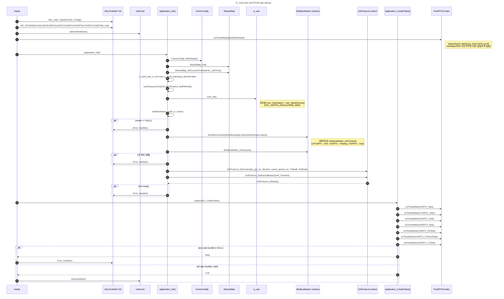

## 전체 Runtime 구성

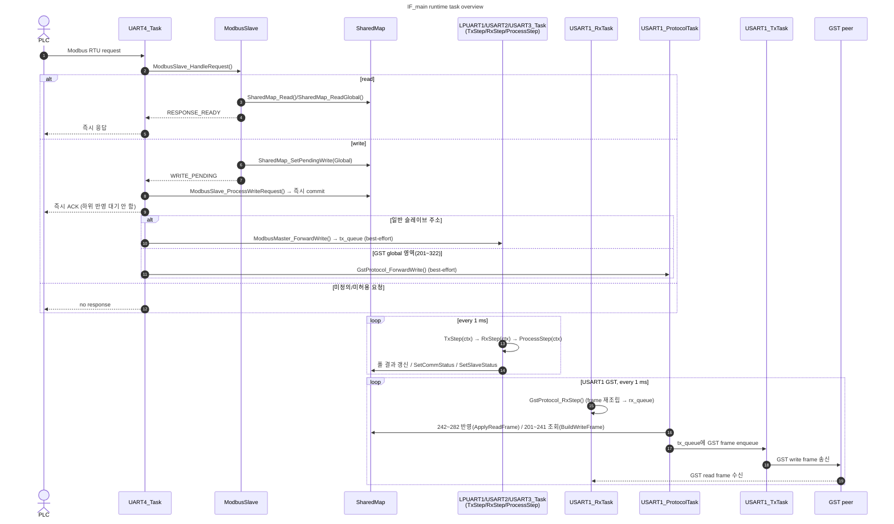

## UART4 PLC Read 흐름

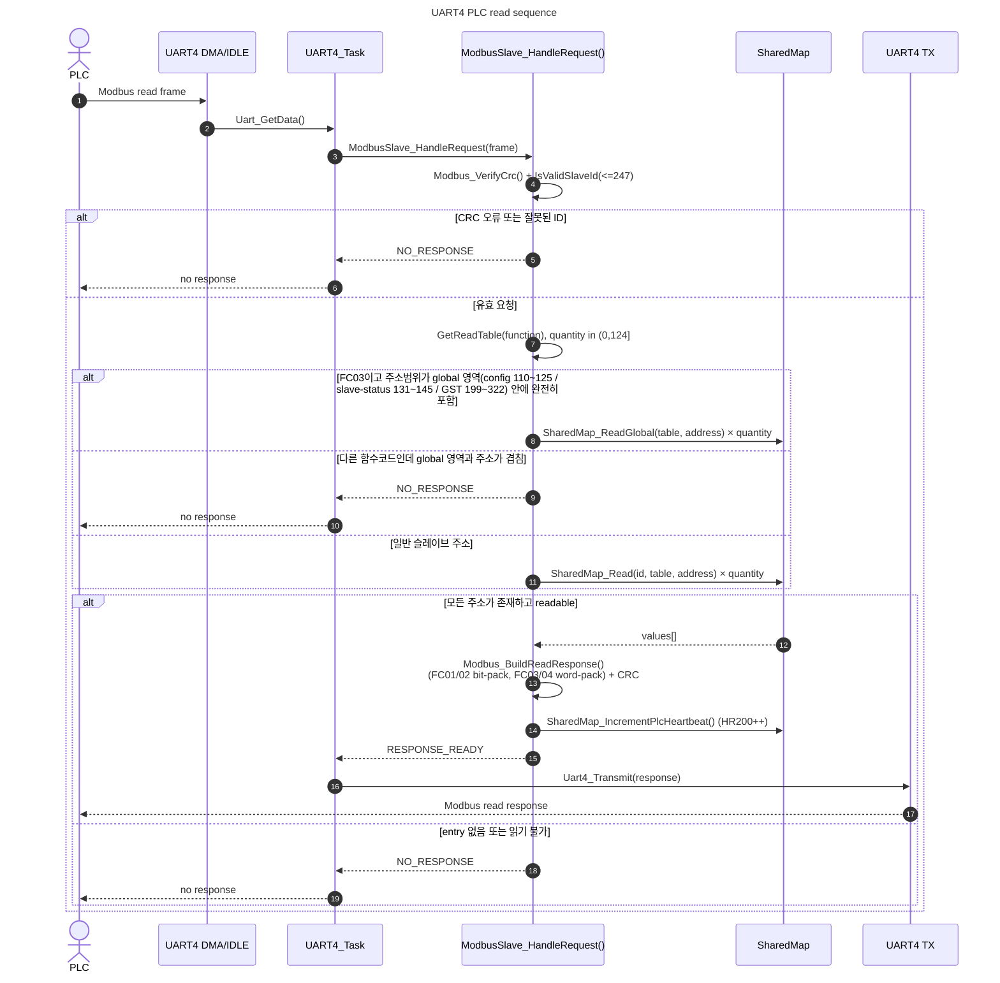

## UART4 PLC Write → 하위 Modbus 장치 (즉시 ACK + 비동기 전달)

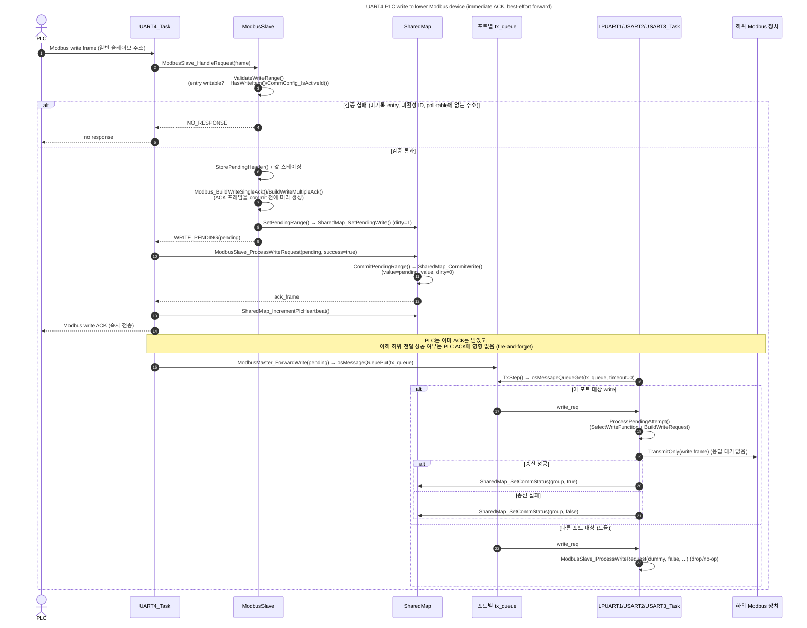

## UART4 PLC Write → USART1 GST Global 영역 (즉시 ACK + best-effort GST 전달)

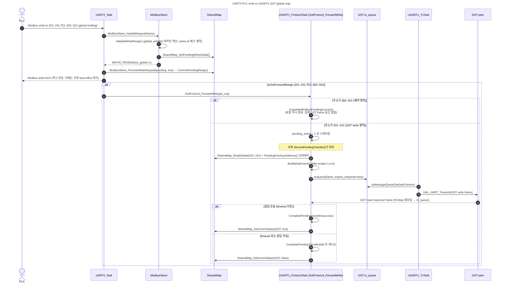

## 하위 Modbus Master Periodic Polling (TxStep/RxStep/ProcessStep)

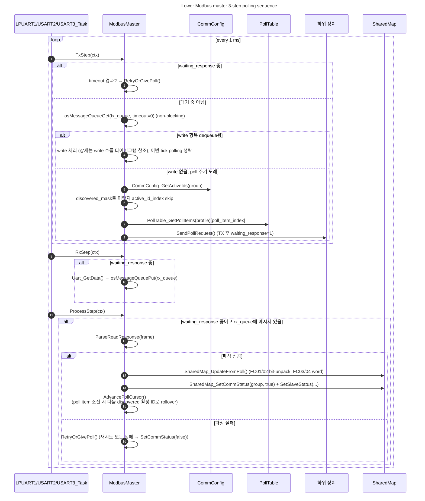

## Slave Discovery 흐름

```mermaid
sequenceDiagram
    autonumber
    title Modbus slave discovery (port task 시작 시 1회)
    participant Task as LPUART1/USART2/USART3_Task
    participant Master as ModbusMaster_DiscoverSlaves()
    participant Config as CommConfig
    participant Device as 하위 장치
    participant Map as SharedMap

    Task->>Master: ModbusMaster_DiscoverSlaves(ctx)
    Master->>Config: CommConfig_GetActiveIds(group)

    loop 각 active ID
        Master->>Device: presence probe<br/>(DIO/Heating: FC03 addr=0 / Gas: FC04 addr=30000(H2) 후 addr=1(TFT))
        alt 응답 있음 (최대 5회 재시도 이내)
            Device-->>Master: probe 응답
            Master->>Master: discovered_mask bit set<br/>(Gas: discovered_profiles[id] = H2 또는 H2_TFT)
        else 5회 재시도 후 무응답
            Master->>Map: SharedMap_SetSlaveStatus(group, index, false) (offline)
            Master->>Master: polling 대상에서 제외 (mask bit 0 유지)
        end
    end

    Master->>Master: 발견된 ID 오름차순 정렬
    loop 발견된 ID (오름차순)
        Master->>Map: SharedMap_RegisterSlave(id, group) (실제 ID 기준 entry 동적 등록)
    end
    Master->>Master: discovery_done = true
```

## UART4 PLC Watchdog Fail-safe 흐름

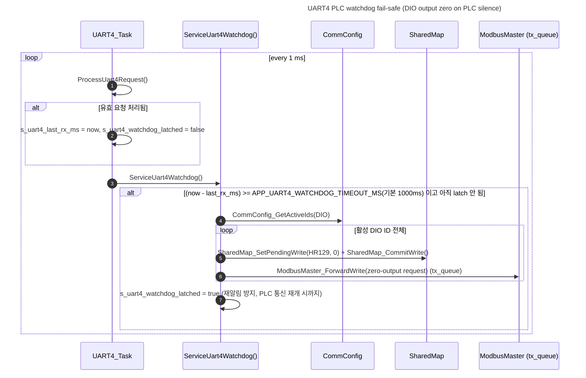

## 런타임 Config Apply 흐름

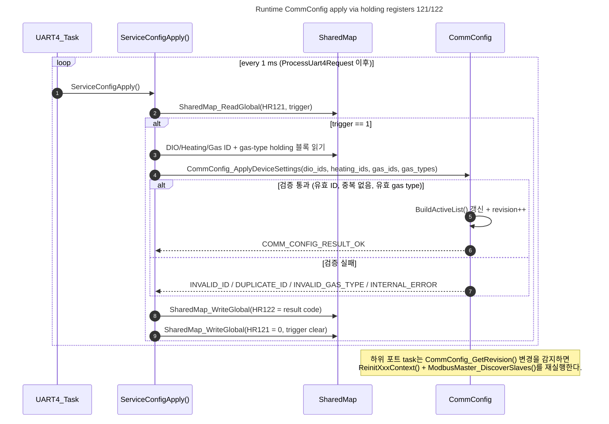

> 참고: `documents/04-data-model.md`(DATA-005)는 "Flash 저장과 PLC register 기반 설정 변경은 초기 구현 범위에서 제외한다"고 기술하고 있으나, 현재 코드에는 HR121/122를 통한 런타임 config apply 메커니즘(`ServiceConfigApply`/`CommConfig_ApplyDeviceSettings`)이 이미 구현되어 있다. 이 다이어그램은 실제 코드 동작을 기준으로 작성했으며, `documents/` 쪽 문서 갱신 여부는 별도로 판단이 필요하다.

## USART1 GST 3-Task 흐름

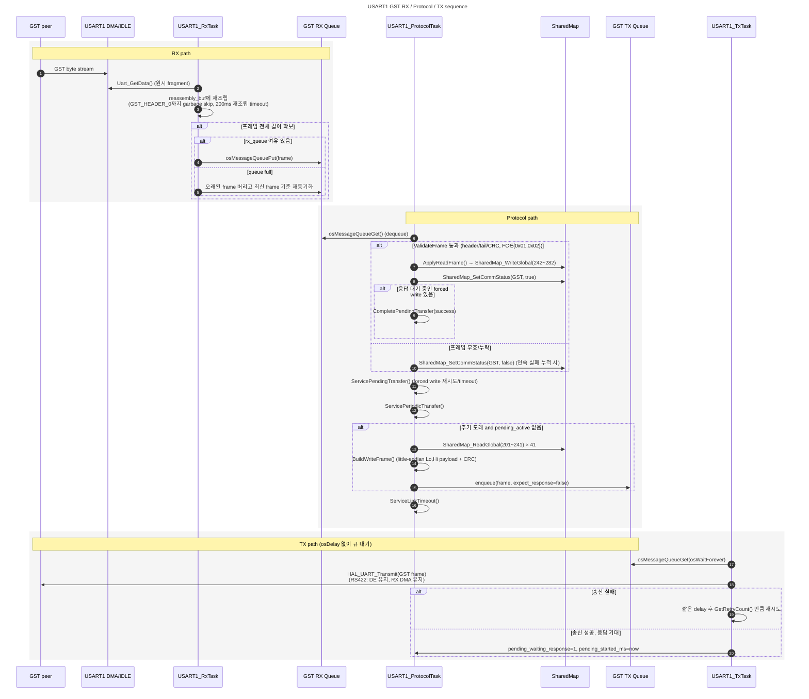

## 공통 UART 수신 흐름

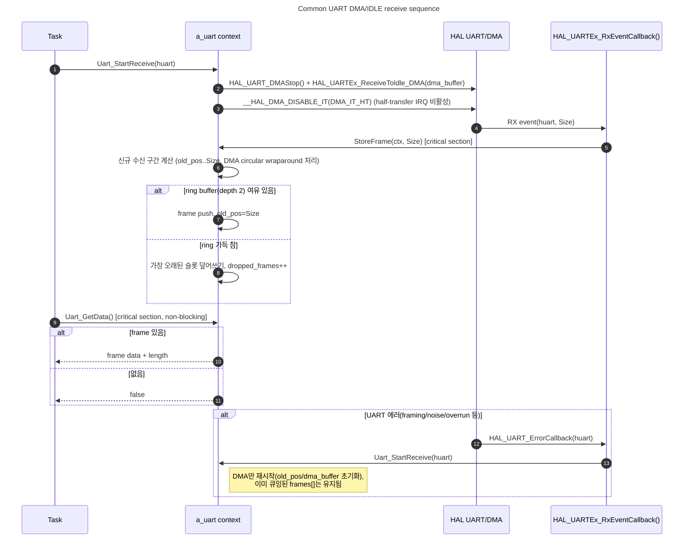

## 변경 이력

- 2026-06-28: 현재 코드 기준 전체 통신 흐름 시퀀스 다이어그램 작성.
- 2026-06-28: Mermaid `sequenceDiagram` 형식으로 변경.
- 2026-07-06: 현재 코드 기준(즉시 ACK + 비동기 전달, TxStep/RxStep/ProcessStep 3단계, Slave Discovery, UART4 watchdog fail-safe, 런타임 Config Apply)으로 전면 갱신. 기존 문서의 blocking-write/단일 `ModbusMaster_Step` 표현을 실제 코드와 일치하도록 교체.
