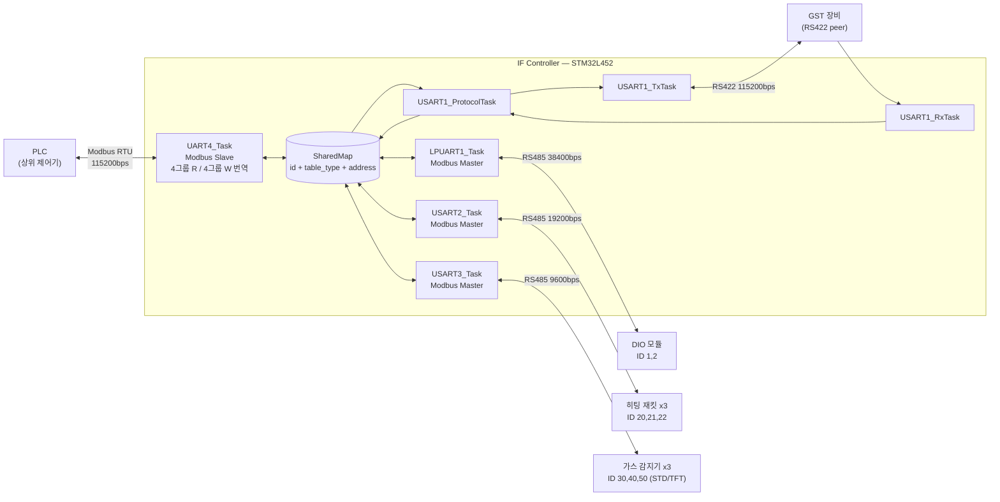
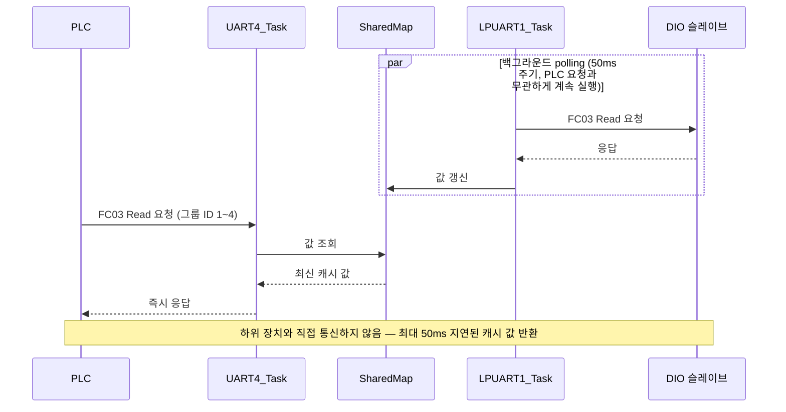
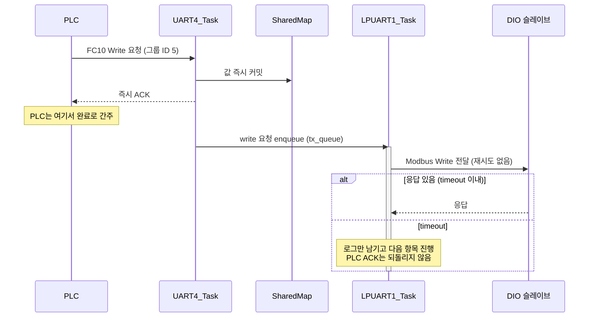
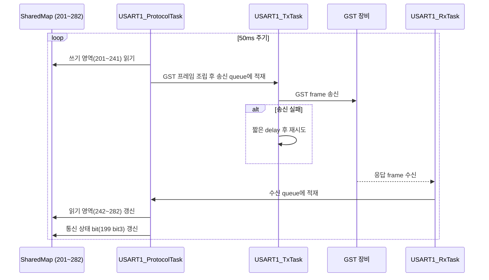

# IF Controller 통신 펌웨어 인수인계 문서

- 작성일: 2026-07-30
- 브랜치: `dev_gjkwon1`
- 최신 커밋: `fc1bed8`
- 대상 보드: STM32L452VE

PLC(Modbus RTU slave) ↔ 하위 장치(Modbus RTU master, DIO / Heating / Gas) ↔ GST peer(USART1) 통합 메모리 맵 기반 통신 펌웨어. 현재까지의 구현 상태, 검증 결과, 미정리 상태를 다음 담당자가 그대로 이어받을 수 있도록 정리한다.

---

## 0. 가장 먼저 확인할 것

- **실 장비 검증 완료 (IMP-007, IMP-008, IMP-010, IMP-014)** — 하위 Modbus master 3포트, USART1 GST 3-task, 전체 통신 시나리오, USB A/B 부트로더까지 실 보드 검증이 2026-07-30 기준 모두 끝났다. `documents/07-implementation-plan.md`, `checklists/03-implementation-completion-checklist.md`, `documents/01-requirements.md`(REQ-021), `documents/02-architecture.md`(ARCH-008), `documents/05-protocol.md`(PROTO-011)에 이 내용을 반영 완료했다.
- **작업 트리에 미커밋 변경 존재** — 참조 사양서 xlsx 파일명 변경이 스테이징되지 않은 상태로 남아 있다 (§5 참조). 커밋 여부 결정 필요.
- **이슈 로그 비어 있음** — `feedback/01-issue-log.md`는 형식만 정의되어 있고 실제 기록이 없다. 알려진 미해결 버그가 있다면 문서에는 없으므로 구두로 전달해야 한다.

---

## 1. 구현 단계 상태

출처: `documents/07-implementation-plan.md`, `checklists/03-implementation-completion-checklist.md`

| ID | 단계 | 작업 | 리뷰 | 검증 |
|---|---|---|---|---|
| IMP-001 | 기존 통신 코드 기준점 확인 | 완료 | 통과 | 빌드확인 |
| IMP-002 | 통신 설정 모듈 (a_comm_config) | 완료 | 통과 | 빌드확인 |
| IMP-003 | 통합 맵 모듈 (a_shared_map) | 완료 | 통과 | 빌드확인 |
| IMP-004 | poll/write item table | 완료 | 통과 | 빌드확인 |
| IMP-005 | UART4 read path 전환 | 완료 | 통과 | 빌드확인 |
| IMP-006 | UART4 write 즉시 ACK 전환 | 완료 | 통과 | 빌드확인 |
| IMP-007 | 하위 Modbus master task | 완료 | 통과 | **장비확인 (2026-07-30)** |
| IMP-008 | USART1 GST 3-task 연동 | 완료 | 통과 | **장비확인 (2026-07-30)** |
| IMP-009 | 기존 bridge hub 제거 | 완료 | 통과 | 빌드확인 |
| IMP-010 | 빌드 및 단계별 검증 | 완료 | 통과 | **장비확인 (2026-07-30)** |
| IMP-013 | 런타임 Config Apply (HR110~122) | 완료 | 통과 | **장비확인 (2026-07-30)** |
| IMP-014 | USB 업데이트 (A/B 부트로더) | 완료 | 통과 | **장비확인 (2026-07-30)** |

관련 요구사항/아키텍처/프로토콜 상태도 모두 `Done`으로 갱신됨: REQ-021, ARCH-008, PROTO-011.

---

## 2. 프로그램이 하는 일

이 보드(코드명 **IF_Controller / Interface Board**)는 **STM32L452VE** 한 칩으로 상위 **PLC**와 하위 현장 장치들(DIO 모듈, 히팅 재킷, 가스 감지기) 그리고 GST 프로토콜을 쓰는 별도 장비 사이에 앉아있는 **통신 중계기**다. 다만 요청을 그대로 흘려보내는 단순 게이트웨이가 아니라, 보드 내부에 **SharedMap**이라는 하나의 데이터 저장소를 두고 그것을 중심으로 동작한다.

### 왜 이렇게 만들었나 — "즉시 응답" 구조

이전 방식은 PLC 요청을 받으면 그 즉시 하위 UART로 그대로 전달(transparent forwarding)하고, 하위 장치가 응답할 때까지 PLC를 기다리게 하는 "브릿지 허브" 구조였다. 이 방식은 하위 장치의 응답 속도, RS485 반이중 충돌, 재시도 지연이 그대로 PLC 쪽 응답 지연으로 전가된다는 문제가 있었다.

지금 구조는 이걸 뒤집었다. 보드는 모든 장치의 최신 값을 SharedMap에 항상 들고 있고, PLC가 뭔가를 물어보면(Read) **하위 장치와 통신하지 않고** SharedMap에 있는 값을 즉시 돌려준다. PLC가 값을 쓰면(Write) 일단 SharedMap에 즉시 반영하고 PLC에는 바로 정상 응답(ACK)을 보낸 다음, 실제 하위 장치·GST 장비로의 전달은 뒤에서 별도 task가 best-effort로 처리한다.

```
PLC Read  → UART4 → SharedMap 조회 → 즉시 응답
PLC Write → UART4 → SharedMap 즉시 커밋 → 즉시 ACK → (백그라운드) 하위 task/GST peer로 best-effort 전달
```

### 5개 UART, 5개의 서로 다른 역할

| 포트 | 역할 | 통신 규격 |
|---|---|---|
| UART4 | PLC ↔ 보드 (상위) | Modbus RTU **Slave**, RS485, 115200bps, 8N1 |
| LPUART1 | DIO 모듈 (하위) | Modbus RTU **Master**, RS485, 38400bps, 8N1 |
| USART2 | 히팅 재킷 (하위) | Modbus RTU **Master**, RS485, 19200bps, 8N1 |
| USART3 | 가스 감지기 (하위) | Modbus RTU **Master**, RS485, 9600bps, Even parity |
| USART1 | GST 장비 (별도 peer) | **GST 전용 프로토콜**(Modbus 아님), RS422, 115200bps, 8N1 |

5개 모두 DMA circular + IDLE 인터럽트 방식으로 수신하는 공통 계층(`a_uart.c`) 위에서 동작한다.

### SharedMap — 모든 값이 모이는 중앙 저장소

SharedMap은 `id + table_type + address` 세 가지를 key로 값을 저장하는 정적(static) 테이블이다. 예를 들어 "DIO 슬레이브 1번의 Holding Register 129번"과 "히팅 슬레이브 20번의 Holding Register 129번"은 주소 숫자는 같아도 완전히 다른 entry로 취급된다. 외부통신프로토콜 사양서에 나온 주소는 모두 부팅 시점에 미리 만들어두며(런타임에 새 주소를 자동 생성하지 않음), 사양서에 없는 주소나 등록되지 않은 ID로 오는 요청은 **응답하지 않는다**(Modbus exception도 보내지 않음).

USART1의 GST 공용 영역(주소 `199~322`)만은 예외적으로 슬레이브 ID가 없는 **global entry**로 취급되어, 어떤 Slave ID로 요청하든 같은 값을 공유한다.

### PLC가 보는 화면 — 4-그룹 통합 Read/Write 맵 (최신 설계, PROTO-012)

가장 최근에 확정된(2026-07-14) 설계 변경으로, PLC는 더 이상 DIO가 몇 번 ID인지, 히팅이 몇 번인지 같은 물리 슬레이브 구성을 몰라도 된다. `UART4_Task`가 번역 계층 역할을 해서, PLC에게는 Slave ID 4개(Read용) + 4개(Write용), 총 8개의 "가상 그룹"과 연속된 주소 범위만 보여준다.

| 방향 | Slave ID | 그룹 | 주소 범위 | 내용 |
|---|---|---|---|---|
| Read | 1 | DIO | 1~2 | DI#1, DI#2 |
| Read | 2 | Heating (1/2/3 병합) | 3~110 | 재킷별 온도 18채널 + 알람 18채널 × 3대 |
| Read | 3 | Gas (STD+TFT 병합) | 111~122 | 3슬롯 × (농도 + 상태비트 패킹) |
| Read | 4 | Backup Interface | 123~164 | User Read Data 01~40 + Heartbeat ×2 |
| Write | 5 | DIO | 201~202 | DO#1, DO#2 |
| Write | 6 | Heating (1/2/3 병합) | 203~265 | 재킷별 Machine ON/OFF, EEPROM Save, Alarm Reset, SV 온도 18채널 × 3대 |
| Write | 7 | Backup Interface | 266~305 | User Write Data 01~40 |
| Write | 8 | Slave ID 설정 | 306~317 | DIO/Heating/Gas 실제 물리 ID + Gas Type 지정, `317`=적용 트리거 |

**Gas 그룹은 Discovery를 쓰지 않는다(2026-07-14 변경).** 예전에는 부팅 시 자동으로 프로브를 날려 H2인지 H2-TFT인지 판별하는 "Discovery" 로직이 있었지만, 지금은 완전히 제거되었다. 대신 PLC가 Gas Type 레지스터(`HR314~316`, 전역 주소 `118~120`)에 `0=동작 안 함 / 1=STD(H2) / 2=TFT` 값을 직접 써서 슬롯별 타입을 지정하고, `317`(전역 `121`)에 `1`을 쓰면 즉시 반영된다. Gas active ID 기본값도 `{31, 40, 30}`에서 `{30, 40, 50}`으로 바뀌었다.

### 하위 장치 폴링 — LPUART1 / USART2 / USART3

| Task | 포트 | 대상 장치 | Active ID (기본값) | 응답 타임아웃 |
|---|---|---|---|---|
| LPUART1_Task | LPUART1 | DIO 모듈 | {1, 2} | 50 ms |
| USART2_Task | USART2 | 히팅 재킷 ×3 | {20, 21, 22} | 200 ms |
| USART3_Task | USART3 | 가스 감지기 ×3 (STD 또는 TFT) | {30, 40, 50} | 100 ms |

세 task 모두 같은 원칙으로 움직인다 — **PLC가 요청한 pending write가 있으면 그것을 최우선으로 먼저 내보내고**, 없으면 active ID를 순서대로 돌면서 사양서 표에 정의된 poll item을 하나씩 처리한다. 끝까지 돌면 처음으로 rollover한다. 연속 3회 timeout/실패면 해당 장치군을 "비정상"으로 표시(주소 `199`의 상태 bit)하고, 1회만 성공해도 바로 "정상"으로 복귀시킨다. write 전달은 read polling과 달리 **재시도하지 않는다**(best-effort).

### USART1 — GST 프로토콜 (Modbus가 아니다)

USART1은 Modbus master도 slave도 아니고, 완전히 별도의 **GST**라는 사용자 정의 프레임 프로토콜을 쓴다. RS485가 아니라 RS422 4선식이며, 3개의 전용 task(`USART1_RxTask` / `USART1_ProtocolTask` / `USART1_TxTask`)가 수신 → 해석/조립 → 송신을 파이프라인으로 나눠 처리한다.

```
[Header 3B 'G''S''T'][FuncCode 1B][Addr Hi/Lo][Length][Data N][CRC16 2B][Tail 2B 'S''I']
```

SharedMap의 `201~241`(41개, GST 쓰기 영역)은 `USART1_ProtocolTask`가 주기적으로 읽어 GST 프레임으로 조립해 상대 장비로 보내고, GST 장비가 보내온 값은 `242~282`(41개, GST 읽기 영역)에 반영한다. `283~322`는 예비 영역이다.

### 런타임 설정 변경 & 안전장치

- **런타임 Config Apply** — PLC가 재부팅 없이 HR`110~122`(그룹 8 기준 `306~317`)로 DIO/Heating/Gas active ID와 Gas Type을 바꿀 수 있다. Flash에는 저장되지 않아 전원이 나가면 컴파일 타임 기본값으로 되돌아간다.
- **UART4 워치독 Fail-safe** — PLC 요청이 `APP_UART4_WATCHDOG_TIMEOUT_MS`(기본 1000ms) 동안 끊기면 DIO 출력을 전부 0으로 강제 write한다.
- **상태 LED** — `MODULE_RUN`은 RTOS가 정상 기동하면 켜지고 계속 유지된다. `MODULE_ERROR`는 HardFault가 나면 인터럽트 핸들러가 직접 켜고 그대로 멈춘다.

### USB 펌웨어 업데이트 (2026-07-30 실 보드 검증 완료)

ST-Link로 물리적으로 재플래싱하지 않아도, 앱이 상시 열어두는 USB CDC(가상 COM포트)로 PC용 C# GUI에서 새 펌웨어를 넣을 수 있다. 플래시를 부트로더(48KB) + Slot A(224KB) + Slot B(224KB) + 메타데이터로 나누고, 현재 실행 중이 아닌 슬롯에만 새 이미지를 쓴다. CRC32 검증 후 `PENDING_TEST` 상태로만 표시하고, 새 펌웨어가 정상 기동해 스스로 `CONFIRMED`를 선언해야 확정된다 — 부팅에 실패하거나 멈추면 워치독(IWDG)이 리셋시키고 부트로더가 자동으로 이전 슬롯으로 롤백한다. A/B 왕복 업데이트·롤백 시나리오는 2026-07-30 검증 완료.

---

## 3. 블록도 & 시퀀스 다이어그램

### 블록도 — 전체 버스 구성



### 시퀀스 1 — PLC Read (즉시 응답)



### 시퀀스 2 — PLC Write (즉시 ACK + 비동기 전달)



### 시퀀스 3 — USART1 GST 송수신



---

## 4. 최근 커밋 (최신 10개)

| 커밋 | 내용 |
|---|---|
| `fc1bed8` | docs: rename reference xlsx file (Rev00 → Rev00 1) |
| `b0fb3d7` | docs: README 정리, 커뮤니케이션 체크리스트 추가, work log 갱신 |
| `91af539` | fix: Gas TFT status DI polling address off-by-one (1부터 → 0부터) |
| `01a74bc` | fix: forwarded DIO write가 slave 응답을 받은 뒤 다음 TX로 진행하도록 수정 |
| `07f2db8` | chore: IDE 메타데이터 동기화, MXC-HIF 시스템 스펙 산출물 추가 |
| `7b2a24a` | docs: agent 작업 범위 명확화 |
| `173c9e7` | feat: PLC group map 추가, 인터럽트 기반 UART TX |
| `f88dbbf` | fix: Apply-without-reboot 통신 hang 수정, UART4 host link 안정화 |
| `427f678` | fix: VTOR slot offset 수정, UART 에러 복구를 task context로 이동 |
| `2e47b7e` | feat: USB 펌웨어 업데이트(부트로더, A/B 이중 슬롯, C# GUI) 추가 |

`91af539`, `01a74bc` 두 건은 IMP-007 실 장비 검증(2026-07-30) 범위에서 함께 확인된 것으로 보인다.

---

## 5. 작업 트리 미정리 상태

인수 시점 기준 `git status`에 다음이 남아 있다. 커밋할지, 되돌릴지 결정이 필요하다.

| 상태 | 경로 | 비고 |
|---|---|---|
| 삭제됨 | `ai_work_documents/references/MXC-HIF_..._Rev00 1.xlsx` | 파일명에 공백 포함 원본 |
| 신규(미커밋) | `ai_work_documents/references/MXC-HIF_..._Rev001.xlsx` | 위 파일의 개명본으로 추정 |
| 수정 | `.settings/language.settings.xml` | Eclipse/CubeIDE 설정, 통상 로컬 환경 차이 |
| 수정 | `../.metadata/**` (다수) | CubeIDE 워크스페이스 메타데이터, 코드 변경 아님 |

---

## 6. 문서 지도

모든 에이전트/작업자는 시작 시 `ai_work_documents/INDEX.md`를 먼저 읽는 규칙이 적용 중이다.

| 문서 | 용도 |
|---|---|
| `documents/01~06` | 요구사항 · 아키텍처 · 인터페이스 · 데이터모델 · 프로토콜 · 설계결정 (ID 기반 누적) |
| `documents/07-implementation-plan.md` | 구현 단계, 완료 기준, SDD/subagent 진행 규칙, "현재 구현 상태" 최신 요약 |
| `documents/08-implementation-notes.md` | IMP-013, IMP-014 등 구현 세부 소급 기록 |
| `checklists/03-implementation-completion-checklist.md` | 단계별 작업/리뷰/검증 상태 |
| `feedback/02-work-log.md` | 대화 기준 결정 이력 — 왜 이렇게 됐는지 확인할 때 1순위 |
| `feedback/01-issue-log.md` | 문제 기록 (현재 비어 있음) |
| `agent-guides/13-protected-paths.md` | 수정 금지 경로 — 코드 변경 전 확인 |

---

## 7. 인수자 실행 체크리스트

- [ ] 미커밋 xlsx 리네임 처리 — 커밋할지 여부 결정 후 정리.
- [ ] 알려진 미기록 이슈 구두 전달 — `01-issue-log.md`가 비어 있으므로, 있다면 별도로 공유.
- [ ] `08-implementation-notes.md`의 IMP-013/IMP-014 상세 기록과 실제 코드가 일치하는지 확인.

---

*IF_Controller / IF_main · dev_gjkwon1 · generated 2026-07-30*
