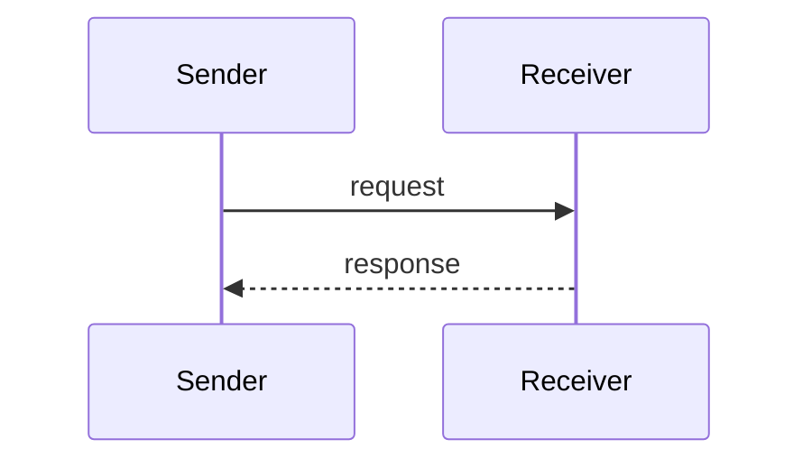
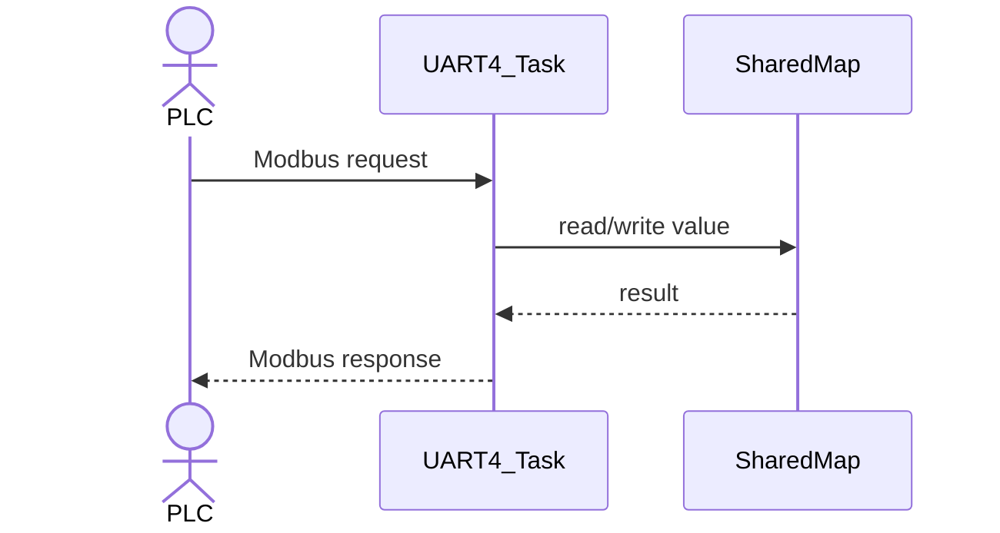

# Artifacts Guide

이 폴더는 사용자에게 전달하거나 결과물로 남기는 산출물을 보관하는 곳이다.

## 사용 원칙

- 시퀀스 다이어그램, 설명용 다이어그램, 검토 보고서, 최종 요약 문서처럼 결과물 성격의 파일을 둔다.
- 요구사항, 설계, 인터페이스, 데이터 모델, 프로토콜, 구현 계획처럼 프로젝트를 관리하는 문서는 `ai_work_documents/documents/`에 둔다.
- 작업 방식, 임시 규칙, 사용자 추가 지시는 `ai_work_documents/agent-guides/`에 둔다.
- 외부 자료, 데이터시트, 기존 사양서는 `ai_work_documents/references/`에 둔다.
- 모든 `.md` 파일은 UTF-8 인코딩으로 작성하고 저장한다.

## 예시

- `01-sequence-diagrams.md`: Mermaid 기반 동작 시퀀스 다이어그램.
- 특정 구현 검토 결과 보고서.
- 사용자 전달용 최종 요약.

## Mermaid 사용법

Mermaid는 `.md` 파일 안에 텍스트로 다이어그램을 작성하고, Markdown 미리보기에서 이미지처럼 렌더링해서 보는 방식이다.

### 작성 위치

- 산출물 성격의 다이어그램은 이 폴더의 `.md` 파일에 작성한다.
- 요구사항, 인터페이스, 프로토콜 정의 자체가 바뀌는 내용은 `ai_work_documents/documents/`의 관련 문서에도 반영한다.
- 현재 전체 코드 시퀀스 다이어그램은 `01-sequence-diagrams.md`에 작성한다.

### 기본 작성 형식

Mermaid 다이어그램은 fenced code block으로 작성한다.

````markdown

````

### 시퀀스 다이어그램 작성 기준

- 코드 동작 흐름은 `sequenceDiagram`을 사용한다.
- 반복 처리는 `loop ... end`로 표현한다.
- 조건 분기는 `alt ... else ... end`로 표현한다.
- 호출은 `->>`를 사용하고, 응답 또는 반환은 `-->>`를 사용한다.
- 외부 주체는 `actor`, 내부 모듈이나 task는 `participant`로 표현한다.
- 메시지는 코드 함수명이나 실제 동작을 기준으로 짧게 작성한다.

예:

````markdown

````

### 이미지처럼 보는 방법

VS Code에서 보는 방법:

1. Mermaid가 들어 있는 `.md` 파일을 연다.
2. `Ctrl + Shift + V`를 눌러 Markdown Preview를 연다.
3. Mermaid 블록이 다이어그램 이미지처럼 표시되는지 확인한다.

VS Code에서 보이지 않는 경우:

- 확장 프로그램에서 `Markdown Preview Mermaid Support`를 설치한다.
- 확장 설치 후 `.md` 파일을 다시 열고 `Ctrl + Shift + V`로 확인한다.

GitHub 또는 GitLab에서 보는 방법:

- 저장소에 `.md` 파일을 올린 뒤 웹 화면에서 파일을 열면 Mermaid가 자동 렌더링된다.

### 주의 사항

- Mermaid 블록 안에는 PlantUML 문법인 `@startuml`, `@enduml`, `database`, `queue`를 사용하지 않는다.
- Mermaid 렌더러에 따라 일부 문법 지원이 다를 수 있으므로, VS Code Markdown Preview에서 표시 여부를 확인한다.
- 다이어그램을 별도 이미지 파일로 저장해야 하는 경우에는 Mermaid CLI 또는 VS Code 확장 기능의 export 기능을 사용한다.

## 주의 사항

- 산출물은 프로젝트 관리 문서와 분리한다.
- 산출물이 요구사항, 설계, 인터페이스, 프로토콜 변경을 포함하면 `documents/`의 관련 문서도 함께 갱신한다.
